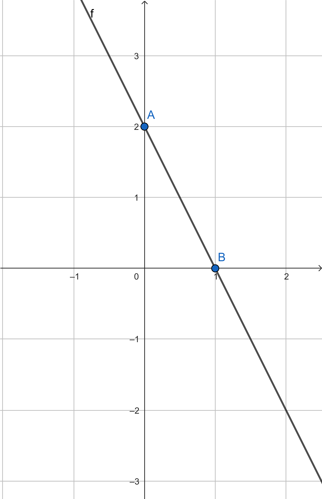
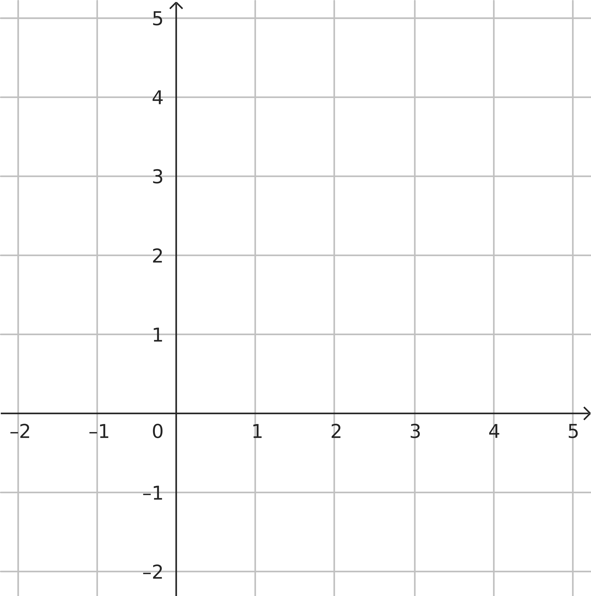

## Domanda 1: equidistante

Il punto sull'asse $x$ equidistante dai punti A(4;1) e B(2;3) è:

* non esiste
* (0; 1)
* (2; 0)
* [(1; 0)]{.fragment .highlight-red}

---

## Domanda 2: parallela

La retta parallela a $3x-y = 5$ e passante per P(0;1) è:

* [$y = 3x + 1$]{.fragment .highlight-red}
* $y = - \dfrac{1}{3} x + 1$
* $y = 3x - 1$
* $y = - \dfrac{1}{3} x - 1$

---

## Domanda 3: retta

:::: {.columns}

::: {.column width="30%"}

:::

::: {.column width="70%"}
Quale di queste equazioni è l’equazione della retta in figura?

* [$y = -2x + 2$]{.fragment .highlight-red}
* $y = x + 1$
* $y = 2x + 2$
* $y = -2x + 1$
:::

::::

---

## Domanda 4: triangoli

:::: {.columns}

::: {.column width="50%"}
L’area del triangolo di vertici A(-1;-2), B(5;1) e C(-1;3) è:

* $\frac{15}{2}$
* -2
* $\frac{15}{3}$
* [15]{.fragment .highlight-red}
:::

::: {.column width="50%"}

:::

::::

---

## Domanda 5: sistema

Il sistema $\begin{cases} 3x + 5y - 1 = 0 \\ 6x + 10y - 3 = 0 \end{cases}$ rappresenta due rette:

* incidenti
* coincidenti
* [parallele]{.fragment .highlight-red}
* perpendicolari

---

## Domanda 6: radicali

Dati i radicali $\sqrt{5}$, $\sqrt[3]{9}$, $\sqrt[4]{13}$, una sola delle seguenti relazioni è corretta:

* $\sqrt{5}< \sqrt[3]{9}< \sqrt[4]{13}$
* [$\sqrt[4]{13} \leq \sqrt[3]{9} \leq \sqrt{5}$]{.fragment .highlight-red}
* $\sqrt[3]{9} \leq \sqrt{5} \leq \sqrt[4]{13}$
* $\sqrt[3]{9} < \sqrt{5} < \sqrt[4]{13}$

---

## Domanda 7: prodotto di radicali

A che cosa equivale $8^{\frac{2}{5}} \cdot 2^{\frac{3}{10}} \cdot 4^{-\frac{3}{5}}$?

* $\sqrt{2^3}$
* $\frac{\sqrt{2}}{4}$
* [$\sqrt[10]{2^3}$]{.fragment .highlight-red}
* $8^{-\frac{4}{5}}$

---

## Domanda 8: uguaglianze

Quale di queste uguaglianze è vera?

* $\sqrt[10]{(-6)^2} = \sqrt[5]{-6}$
* $\sqrt[10]{(-6)^{2}}=\sqrt[8]{-6}$
* $\sqrt[10]{(-6)^{2}}=\sqrt[8]{6}$
* [$\sqrt[10]{(-6)^2} = \sqrt[5]{6}$]{.fragment .highlight-red}

---

## Domanda 9: C.E.

Per quale valore o quali valori di $a$ la frazione $\dfrac{3a}{a^2-4}$ perde significato?

* $a = 0$
* $a = 4$ e $a = -4$
* $a = -3$
* [$a = 2$ e $a = -2$]{.fragment .highlight-red}

---

## Domanda 10: quadrato di binomio

Quale tra i seguenti polinomi **NON** è il quadrato di un binomio?

* $16x^4 + 8x^2 + 1$
* [$y^2 - 32y + 16$]{.fragment .highlight-red}
* $\frac{1}{4}-x + x^2$
* $25x^2 + 10xy^2 + y^4$

---

## Domanda 11: Scomposizioni

Quale delle seguenti uguaglianze è vera?

* $a^3 - 3a^2 - 1 - 3a = (a - 1)^3$
* [$8x - 1 - 16x^2 = -(1 - 4x)^2$]{.fragment .highlight-red}
* $9a^9 - b^4 = (3a^3 + b^2)(3a^3 - b^2)$
* $3m^2 + n + nm - 3m = (3m + n)(n - 1)$

---

## Domanda 12: Raccoglimento parziale

Usando il raccoglimento parziale è possibile scomporre il polinomio 

$$2x + 6y - 5ax - 15ay$$

in un solo dei seguenti modi. Quale?

* $(x + 3y)(2 + 5a)$
* [$(x + 3y)(2 - 5a)$]{.fragment .highlight-red}
* $(x - 3y)(2 + 5a)$
* $(x - 3y)(2 - 5a)$